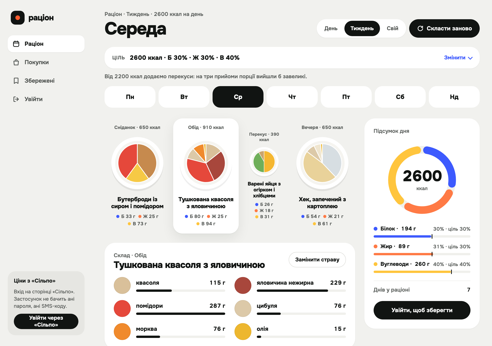
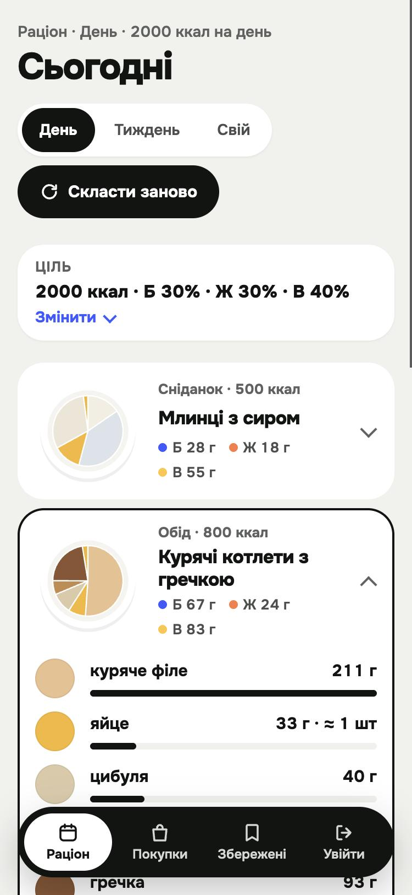
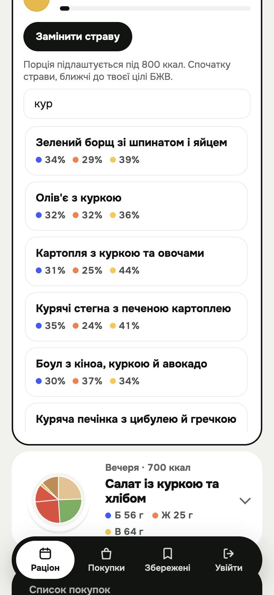
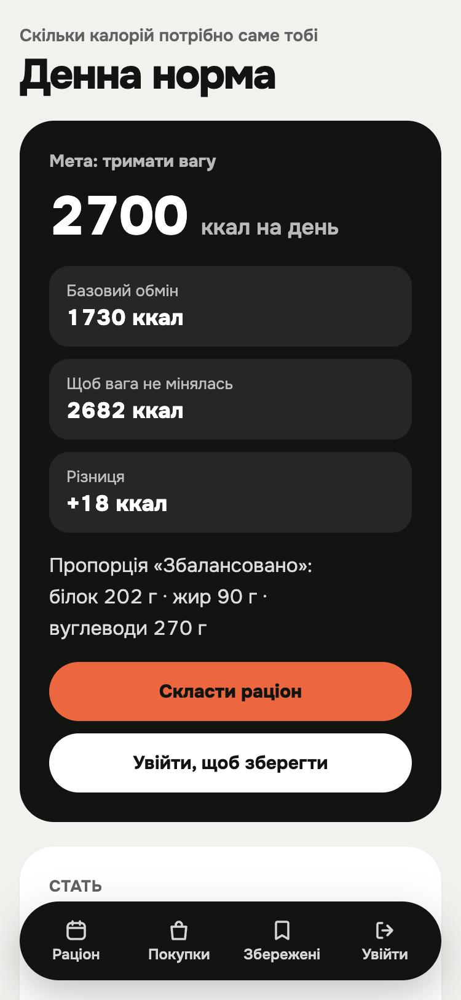
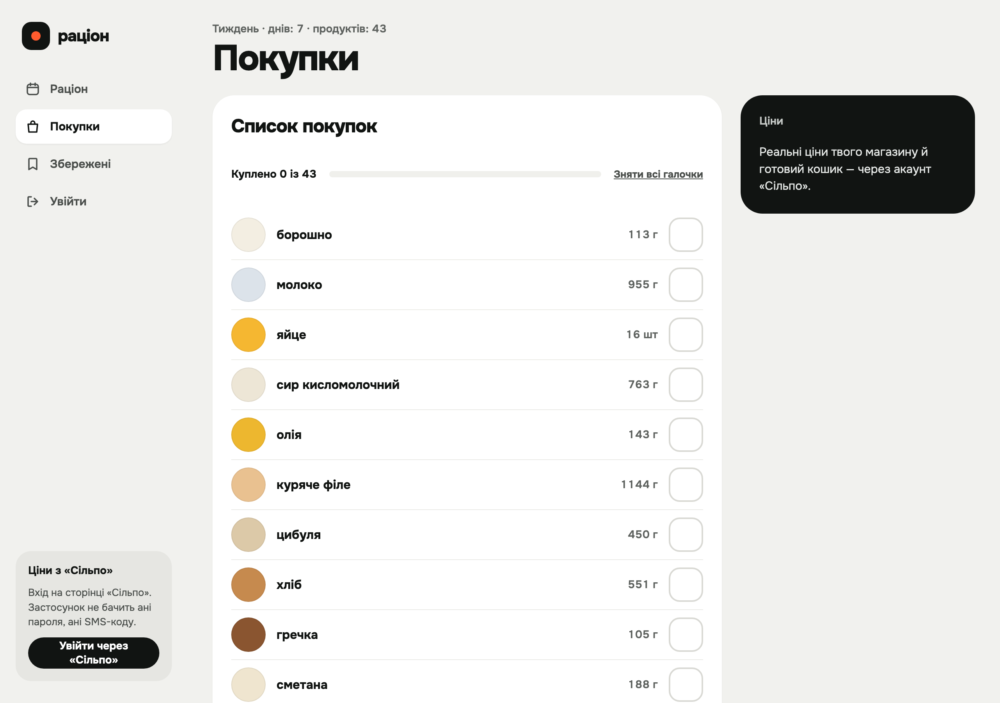

# Racion — Calorie Planner

A Django web app that builds a meal plan for a daily calorie target and a protein / fat / carb split: for one day,
a week or up to 31 days. It picks real dishes, scales every portion to the calories of its meal, and turns the plan
into a shopping list. With a [Silpo](https://silpo.ua) account (a Ukrainian grocery chain) it shows real store prices
and fills the cart.

> The interface is in Ukrainian; the code comments and docstrings are in Ukrainian too.



## Features

- **Meal plan for a target.** Enter calories and a macro split, or pick a preset (Balanced, More protein,
  Fewer carbs). Each day has breakfast, lunch and dinner; from 2200 kcal the app adds one snack, from 2800 kcal two,
  so that no portion grows beyond 1 kg.
- **Real dishes, not product lists.** A catalog of 122 recipes built from 82 products. Nutrition values come from
  USDA FoodData Central.
- **Change anything.** "Rebuild" gives another menu for the same target; "Swap dish" lists every dish that fits the
  meal, closest to the macro target first, with search by dish name or ingredient.
- **Daily calorie calculator.** Mifflin–St Jeor formula with activity level and goal (lose, keep, gain weight).
  The result opens a plan straight away.
- **Shopping list** for the whole period with check marks that survive a page reload and move to the account
  after sign-in.
- **Accounts.** Saved plans and goals, password reset by email, account deletion, a privacy page.
- **Silpo integration.** Real prices for the shopping list, a choice of pack sizes, and adding the plan to the cart.
- **Mobile layout.** On a phone every meal is a card that unfolds into its composition.

<p>
  
  
  
</p>



## How the plan is built

The engine lives in [`nutrition/planner.py`](nutrition/planner.py), separate from the views, so its tests call it
directly, without HTTP requests.

1. **Split the day.** Calories are divided between meals by a fixed schedule, e.g. 25 / 40 / 35 % for
   breakfast / lunch / dinner. Higher targets switch to a schedule with snacks.
2. **Filter.** Each meal only gets dishes marked for it, and only those whose portion at that calorie level stays
   under 1 kg (500 g for a snack).
3. **Score.** A dish's macro shares don't change when the portion is scaled, so each dish is scored once: how far
   its protein / fat / carb shares are from the target, plus penalties for a heavy portion and for repeating dishes.
4. **Shortlist and combine.** For every meal the engine keeps 15 promising dishes, plus the 3 richest in each macro,
   since a dish far from the target alone can be what balances the rest of the day. It then checks every combination
   of the shortlists and picks the day with the best score. The score is a tuple compared left to right, so the rules
   have a strict priority: no dish twice a day → no dish from yesterday → no repeated set of main dishes → closest to
   the macro target. With snacks, checking every combination would take 760 000 checks per day, so the engine
   chooses in three steps: main meals, then snacks for what is missing, then main meals again.
5. **Scale.** Every portion is scaled to the calories of its meal.

"Rebuild" adds a small random shift to every dish's score. The shift is seeded with the variant number, so the same
link always shows the same menu. The whole plan — target, period, variant and swapped dishes — is stored in the URL
query, so any plan can be shared or bookmarked without saving it.

Typical accuracy is within 1 percentage point of the macro target; a month for 3000 kcal is built in about 1.5 s.

## Silpo integration

[`nutrition/silpo.py`](nutrition/silpo.py) talks to the official Silpo MCP server (JSON-RPC over HTTP):

- **OAuth 2.1 with PKCE** and dynamic client registration. The user signs in on the Silpo page; the app never sees
  the password or the SMS code.
- **Tokens stay on the server** (in the Django session) and are refreshed shortly before they expire.
- **Product matching.** Catalog products are searched in batches; pack sizes are parsed from names ("2×500 г",
  "1 кг"), and the app picks how many packs cover the grams in the plan, skipping pickled or canned variants.
- **Cart.** Items are added only when the user clicks the button; the order itself is never placed. The app
  remembers which items it added: those it sets to the exact quantity or removes, while items the user added
  themselves are only increased to the needed quantity and never removed. After every change it reads the cart back,
  because a request can be accepted and still not applied.

## Security

- Settings come from environment variables (`.env` locally); without them the app starts in production mode and
  refuses to run without a secret key.
- Failed logins are limited per email and per IP, registrations per IP, password-reset emails per email and per IP
  ([`login_limits.py`](nutrition/login_limits.py)).
- HTTPS-only cookies, HSTS and HTTPS redirect in production; custom system checks warn before deploy if contact
  email or SMTP settings are missing ([`checks.py`](nutrition/checks.py)).

## Tech stack

Python 3.14 · Django 5.2 · SQLite · vanilla JavaScript · HTML / CSS · Gunicorn · WhiteNoise · Requests

## Project structure

```
config/                  Django settings and root URLs
nutrition/
  planner.py             plan engine
  silpo.py               Silpo OAuth and MCP client
  energy.py              daily calorie calculator (Mifflin–St Jeor)
  login_limits.py        rate limiting for login, registration and password reset
  views.py, account_views.py, norm_views.py
  models.py              products, recipes, saved plans, profiles
  data/catalog.json      products and recipes, loaded with `load_catalog`
  management/commands/   load_catalog, backup_db
  templates/, static/
  tests.py               259 tests
deploy.sh                one-command update on the server
```

## Running locally

```bash
git clone https://github.com/YaroslavBoichuk1/calorie-planner.git
cd calorie-planner
python3 -m venv .venv
.venv/bin/pip install -r requirements.txt
echo "DJANGO_DEBUG=1" > .env
.venv/bin/python manage.py migrate
.venv/bin/python manage.py load_catalog
.venv/bin/python manage.py runserver
```

Open http://127.0.0.1:8000. Create an admin user with `.venv/bin/python manage.py createsuperuser` to edit
products and recipes at `/admin/`. All other settings are described in [`.env.example`](.env.example).

## Tests

```bash
.venv/bin/python manage.py test nutrition
```

259 tests cover the plan engine (macro accuracy, portion limits, variety, speed), views, accounts, rate limits, the
Silpo client (with mocked HTTP), the catalog and the deploy checks.

## Deployment

[`deploy.sh`](deploy.sh) updates the site on a server in one step: pull the code, install requirements, run
`check --deploy`, back up the database, migrate, load the catalog, collect static files and restart the service.
It stops before touching the database if the settings are incomplete or the server has local changes.

## Data

Nutrition values: [USDA FoodData Central](https://fdc.nal.usda.gov/) (SR Legacy), public domain.
